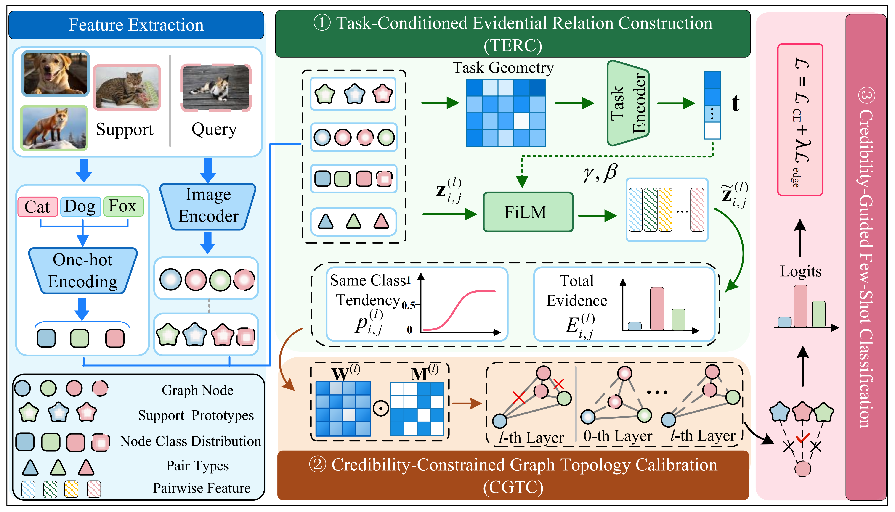

# EGRC



This repository contains the main EGRC method and its experiments on miniImageNet,
tieredImageNet, CIFAR-FS, and FC100. The ViT-S/16 backbone, dataset readers, and
episodic samplers are included. No sibling code repository is needed at runtime.

## Setup

Use Python 3.10 or newer and install the dependencies in your training environment:

```bash
python -m pip install -r requirements.txt
```

Use a matching PyTorch/torchvision installation with CUDA support for GPU training.
The code does not download datasets or initialization weights automatically.
Place the datasets and pretrained ViT-S/16 weights as described in
[datasets/README.md](datasets/README.md) and
[initialization/README.md](initialization/README.md).

## Datasets

The main experiments use the following directory layout. Folder names below
match the existing datasets and are recognized by the included readers.
`<class_name>` denotes a class directory containing its images.

```text
datasets/
├── mini-imagenet/
│   ├── images/
│   │   └── <image_name>.jpg
│   ├── split/
│   ├── imagenet_class_index.json
│   ├── train.csv
│   ├── val.csv
│   └── test.csv
├── tiered_imagenet/
│   ├── train/<class_name>/<image_name>.jpg
│   ├── val/<class_name>/<image_name>.jpg
│   ├── test/<class_name>/<image_name>.jpg
│   └── class_names.json
├── cifar_fs/
│   ├── data/<class_name>/<image_name>.png
│   └── splits/
│       ├── train.txt
│       ├── val.txt
│       └── test.txt
└── FC100/
    ├── train/<class_name>/<image_name>.png
    ├── val/<class_name>/<image_name>.png
    └── test/<class_name>/<image_name>.png
```

miniImageNet CSV files contain a header followed by `filename,label` rows.
They can be placed directly under `mini-imagenet/` or in its `split/` folder;
the reader checks `split/` first. Images can also be grouped by class under
`images/`. CIFAR-FS split text files list one class directory name per line;
the corresponding images are read from `data/<class_name>/`.
`imagenet_class_index.json` and `class_names.json` are optional metadata files.
The directory readers accept `.jpg`, `.jpeg`, `.png`, and `.bmp` images.

The default dataset root is `EGRC-main/datasets/`. To use an existing parent
directory containing these datasets:

```bash
python train.py --config configs/cifarfs_1shot.json --dataset-root /path/to/dataset
```

CUB-200-2011 has the following separate layout. It is used for cross-domain
experiments and is not loaded by the main-experiment entry points in this release.

```text
datasets/CUB_200_2011/
├── attributes/
├── images/
├── parts/
├── split/
├── bounding_boxes.txt
├── classes.txt
├── image_class_labels.txt
├── images.txt
├── README
└── train_test_split.txt
```

## Main settings

| Setting | 1-shot | 5-shot |
|---|---:|---:|
| Classes per episode | 5 | 5 |
| Queries per class | 15 | 15 |
| Edge loss weight, lambda | **0.01** | **0.05** |
| Backbone chunk size | **32** | **32** |
| Graph update steps | 2 | 2 |
| Top-k before symmetric union | 10 | 10 |

All eight configurations use full ViT-S/16 fine-tuning, 100 epochs, 100 training
episodes and 500 validation episodes per epoch. The graph learning rate is 1e-4;
the backbone learning rate is 1e-6. AdamW, cosine decay, five warm-up epochs,
mixed precision, and activation checkpointing follow the established main method.
The edge KL weight warms up over ten epochs.

## Train one experiment

Run from the repository root:

```bash
python train.py --config configs/mini_1shot.json
python train.py --config configs/mini_5shot.json
```

The other configuration prefixes are `tiered`, `cifarfs`, and `fc100`.
To inspect a configuration without importing PyTorch or starting training:

```bash
python train.py --config configs/mini_1shot.json --dry-run
```

For datasets stored elsewhere, pass `--dataset-root /path/to/dataset`.
For a differently located pretrained checkpoint, pass `--init-weights /path/to/file.pth`.
These paths refer only to data and weights; they do not import external code.

Progress is printed during dataset loading, training, validation, and final testing.
Use `--log-every 10` for more frequent episode updates.

## Run the main experiment queue

Preview all eight runs, then execute them sequentially on GPU 0:

```bash
python run_main.py --gpu 0
python run_main.py --gpu 0 --execute
```

Select datasets or shots:

```bash
python run_main.py --gpu 0 --datasets tiered cifarfs fc100 --shots 1 --execute
python run_main.py --gpu 0 --datasets fc100 --shots 5 --dataset-root /data/datasets --execute
```

An existing experiment with training records is protected from overwrite.
Select remaining jobs to continue a partially completed queue, or use
`--run-tag rerun1` to create new experiment names. The queue stops if a run fails.

## Evaluate a checkpoint

```bash
python train.py --config configs/mini_1shot.json --eval-only \
  --checkpoint checkpoints/egrc-mini-5way-1shot-seed42/max_acc.pth
```

Provide the matching dataset, shot configuration, and initialization file.
Main-method checkpoints from the original `tc_eif` implementation retain their
parameter layout and are supported.
Training from `--checkpoint` loads weights into a fresh training run; it does not
restore the optimizer or resume an interrupted epoch.

## Outputs

Each experiment uses its own directory:

```text
logs/egrc-mini-5way-1shot-seed42/
  resolved_args.json
  metrics.jsonl
  test_result.json
checkpoints/egrc-mini-5way-1shot-seed42/
  max_acc.pth
  last.pth
```

Evaluation-only runs write `resolved_args_eval.json` and `evaluation_result.json`,
leaving the original training test result intact.
The generated files, datasets, and checkpoint weights are excluded by `.gitignore`.

## Code layout and checks

```text
train.py                   Main training/evaluation entry point
run_main.py                Main experiment queue
configs/                   Four datasets x 1-shot/5-shot
egrc/model.py              Task context, TERC, CGTC, episodic classification, losses
egrc/train.py              Training, validation, testing, checkpoints
egrc/backbones/            Included original ViT-S/16 implementation
egrc/data/                 Included dataset readers and episode samplers
tests/                     Model, sampling, configuration, training, and queue checks
```

```bash
python -m unittest discover -s tests -v
```

This is a source-only main-experiment release. It contains no historical results,
trained weights, ablation scripts, sensitivity sweeps, or cross-domain experiments.
The configured lambda values and chunk size are the release settings; historical
paper scores obtained with different settings should not be treated as new results.

Some inactive diagnostic parameters and the zero message input slot retain their
original layout to preserve checkpoint compatibility and seeded model equivalence.
The released training path uses the EGRC graph classifier and classification plus
evidential edge loss.

## Acknowledgement

This repository is built using components of the [FewTURE](https://github.com/mrkshllr/FewTURE)
repository for pretraining.

